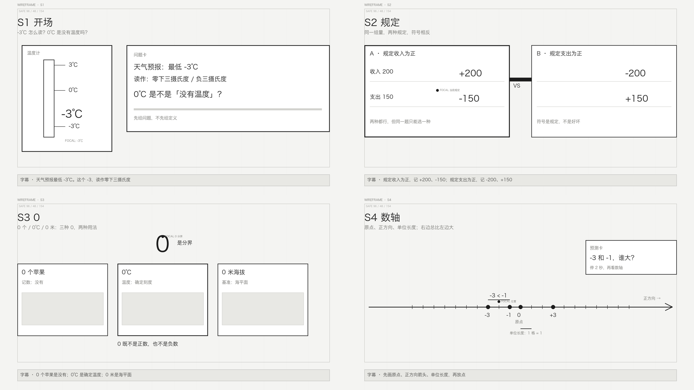

# 初中数学第一课 · 线框 v1（S1–S4）

- 日期：2026-11-05
- 对应版式卡：[版式卡 v1](2026-11-05-初中数学第一课-版式卡v1.md)
- 对应分镜：[分镜 v1](2026-11-05-初中数学第一课-分镜v1.md)
- 方法：[分镜版式卡](../knowledge/方法论/storyboard-layout-cards.md)
- 结论：**4 个母版线框通过，带 3 处调整进入 40 秒样片**

## 1. 线框总览

单张：

- [S1 开场](wireframes/s1.png)
- [S2 规定](wireframes/s2.png)
- [S3 0](wireframes/s3.png)
- [S4 数轴](wireframes/s4.png)

## 2. 逐镜检查

| Scene | 焦点 | 构图 | 问题 | 裁决 |
|---|---|---|---|---|
| S1 开场 | -3℃ | 左温度计 / 右问题卡 | 大 -3℃ 与刻度标签重复；焦点标注不要压数值 | 通过，删重复刻度或改成只保留大 -3 |
| S2 规定 | 当前规定 | 左右等宽 | 两栏同时存在，必须靠「亮/暗」区分当前；VS 条离右卡太近 | 通过，动效必须做 active 状态 |
| S3 0 | 0 是分界 | 三格 + 大 0 | 大 0 在卡片上方，和「分界」关系略弱 | 通过，0 与三格之间加一条细引线 |
| S4 数轴 | -3/-1 位置 | 全宽数轴 | 初版原点/负数位置错；已修为 0 居中、-3/-1 在左、+3 在右 | 通过 |

## 3. 线框阶段确认的 4 条规则

1. **每镜一个焦点**：S1 是 -3℃，S2 是当前规定，S3 是 0，S4 是 -3/-1 的相对位置。
2. **母版结构稳定**：S2 两栏、S3 三格、S4 全宽数轴，后续只换内容不换骨架。
3. **字幕区独立**：底部 966–1030 是字幕，主体不进入。
4. **S4 的数轴必须有原点/箭头/等距单位**：初版画错，说明「先画结构再放点」的检查有效。

## 4. 进入 40 秒样片前的 3 个调整

1. S1：去掉重复的 -3 刻度，只保留大 -3℃ + 3/0 刻度；
2. S2：动效里必须做「当前栏亮、另一栏压暗 20%」；
3. S3：大 0 与三格之间加一条细引线，明确「0 是分界」。

## 5. 下一步

- 按线框做 **S1–S4 的 40 秒动态样片**（先不做 S5–S7）；
- 样片重点验证：黑板风、数轴构建、单行字幕、预测卡、当前栏 active；
- 样片通过后再补 S5–S7，最后全片 4:15。
